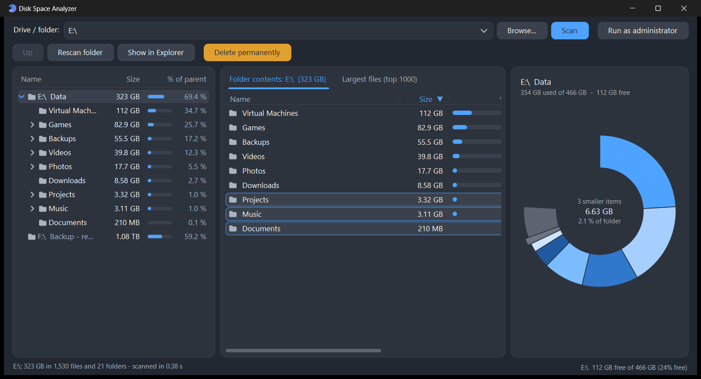
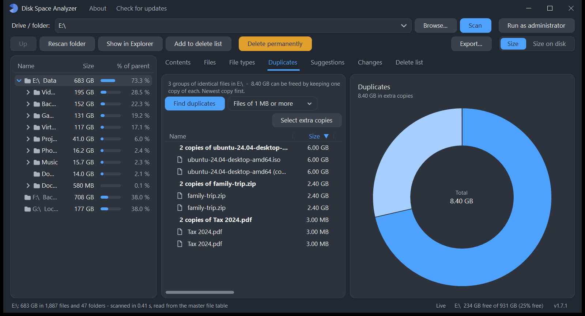

<p align="center">
  
</p>

<h1 align="center">Disk Space Analyzer</h1>

<p align="center">The fastest free disk space analyzer and cleaner for <b>Windows</b> and <b>macOS</b>.<br>
Open source, a single small app, nothing to install.</p>

<p align="center"><a href="../../releases/latest"><b>Download the latest release</b></a></p>



It starts analyzing your system drive the moment it opens. See where your space
went, find big, old and duplicate files, follow cleanup suggestions, and delete
what you don't need, to the Recycle Bin / Trash or permanently.

## Features

**Fast scanning**

- **A whole drive in seconds.** On Windows, run as administrator and it reads an
  NTFS drive's master file table directly: over a million files in about ten
  seconds. Otherwise, and on macOS, it scans folders in parallel with the
  operating system's fastest directory calls.
- **Starts right away, in the background.** The system drive is scanned when the
  app opens, with progress and **Cancel**; you can browse while it runs. Other
  drives and USB disks are listed and scanned when you ask.
- **Live updates.** Files that appear, change or go away update the results
  within seconds, without rescanning.
- **Size on disk** (the default) or **file size**, switched with one click.
  Compressed files count what they really take, hard links count once, and cloud
  files that are not downloaded (OneDrive online-only, iCloud) count nothing and
  are never downloaded by the scan.

**Seeing where the space went** (tabs above the list; the chart always shows the
open list, and hovering a slice highlights its row and the other way round)

- **Contents:** the selected folder's subfolders and files with size, share,
  change since the last scan, counts and dates. The ring chart shows the folder
  and, in two outer rings, its subfolders. Click a part to open it; click the
  centre (the folder's name) to go back up. For a drive it also shows free space.
- **Files:** the largest files, with a name search (`*.iso`, `invoice`) and
  filters by type, size and age ("older than 1 year"). Instant, from memory.
- **File types:** space by extension or by category (videos, images, archives,
  disk images, installers...).
- **Duplicates:** files with identical content; **Select extra copies** keeps
  the newest of each group.
- **Suggestions** (the green tab next to Contents): how much can be freed, in
  large print, and what: the Recycle Bin / Trash, temporary files, caches
  (browsers, developer tools, Xcode, Homebrew...), `node_modules` folders, old
  installers in Downloads, and more, each with what deleting it means. Expand a
  suggestion to see every location, check exactly what you want (**Select all** /
  **Deselect all**) and **Delete permanently** right there. Safe items start
  checked; items to review first start unchecked.
  Suggestions are looked up again whenever the disk changes or you rescan.
- Hover any row or folder to see its full name and path.
- **Apps:** every installed app with its real size on disk (Windows: programs and
  Microsoft Store apps; macOS: apps in Applications). Expand an app to see
  everything that belongs to it: its program folder, settings and caches
  (AppData / ~/Library), shared data, shortcuts and, on Windows, registry keys.
  **Uninstall...** on Windows runs the app's own uninstaller, checks everything
  again and asks to delete whatever is left (registry keys are saved to a `.reg`
  backup first). On macOS one confirmation moves the app and all its files to
  the Trash.
- **Changes:** which folders grew or shrank since the previous scan.



**Cleaning up**

- **Delete list:** collect items from any tab, review them together, then
  **Move to Recycle Bin / Trash** (can be undone) or **Delete permanently**
  (frees the space now). If some files are in use, the list keeps what is left,
  with its real size.
- Or delete straight from any list, always after a confirmation that shows the
  items and their total size, with a warning for system folders.
- Links are never followed, so nothing outside what you picked is touched; very
  long paths work; caches are emptied and files in use are skipped.

**And**

- **Export** a folder as an HTML report or as CSV.
- **Updates itself:** it checks for a new version at startup and installs it in
  a click.
- **About** lists the keyboard shortcuts and how to get the fastest, most
  complete scans.
- Dark, flat, rounded design.

## Download and install

Get the files from the [latest release](../../releases/latest).

### Windows

Download `DiskSpaceAnalyzer.exe` and run it; there is nothing to install
(Windows 10 or 11). For the fastest whole-drive scans, click **Run as
administrator** in the toolbar.

### macOS

Download `DiskSpaceAnalyzer-macOS.dmg`, open it and drag **Disk Space Analyzer**
onto **Applications**. It runs natively on Apple silicon and Intel Macs, macOS 11
or later.

- **First start:** the app is not signed with an Apple Developer ID, so macOS
  blocks it the first time. Right-click the app, choose **Open**, then **Open**
  again (or click **Open Anyway** in **System Settings > Privacy & Security**).
- **Full Disk Access:** on first start the app asks for it. Turn it on in
  **System Settings > Privacy & Security > Full Disk Access**, then reopen the
  app. Without it, macOS asks separately for every protected folder (Desktop,
  Documents, Downloads, iCloud Drive...) and hides some sizes.

## Using it

1. The app scans your system drive as soon as it opens.
2. To analyze another drive, select it in the tree and press **Scan** (or
   double-click it). For any folder, type or choose it, or drag it onto the
   window, and press **Scan**.
3. Explore the tree, the tabs and the chart. **Files**, **File types** and
   **Duplicates** work on the folder selected in the tree.
4. Add what you want gone to the **Delete list**, review it, then move it to the
   Recycle Bin / Trash or delete it permanently.

> ⚠️ **Delete permanently cannot be undone.** Use **Move to Recycle Bin / Trash**
> if you may want something back.

### Keyboard shortcuts

| Action | Windows | macOS |
|---|---|---|
| Open the selected folder or file | <kbd>Enter</kbd> | <kbd>Return</kbd> |
| Up to the parent folder | <kbd>Backspace</kbd> | <kbd>⌘</kbd><kbd>↑</kbd> |
| Rescan the selected folder (circular arrow button) | <kbd>F5</kbd> | <kbd>⌘</kbd><kbd>R</kbd> |
| Add to the delete list | <kbd>Ctrl</kbd>+<kbd>D</kbd> | <kbd>⌘</kbd><kbd>D</kbd> |
| Delete permanently | <kbd>Ctrl</kbd>+<kbd>Shift</kbd>+<kbd>D</kbd> (or <kbd>Del</kbd>) | <kbd>⇧</kbd><kbd>⌘</kbd><kbd>D</kbd> (or <kbd>⌘</kbd><kbd>⌫</kbd>) |
| Check / uncheck in Suggestions | <kbd>Space</kbd> | <kbd>Space</kbd> |
| Search files | <kbd>Ctrl</kbd>+<kbd>F</kbd> | <kbd>⌘</kbd><kbd>F</kbd> |
| Copy path | <kbd>Ctrl</kbd>+<kbd>C</kbd> | right-click menu |
| Export | | <kbd>⇧</kbd><kbd>⌘</kbd><kbd>E</kbd> |
| About | <kbd>F1</kbd> | app menu |

### Privacy

Nothing leaves your computer. The only network request is the update check
against this repository's releases. The last scan of each drive or folder (folder
names and sizes only) is kept locally so the next scan can show what changed.

## Build from source

**Windows:** no Visual Studio or SDK needed, it compiles with the C# compiler
built into Windows.

```powershell
git clone https://github.com/sphrd/DiskSpaceAnalyzer.git
cd DiskSpaceAnalyzer
.\build.ps1
```

`DiskSpaceAnalyzer.exe` appears in the repository root (close a running copy first).

**macOS:** needs the Xcode Command Line Tools and python3.

```bash
bash macos/build.sh
```

This builds a universal `Disk Space Analyzer.app` and `DiskSpaceAnalyzer-macOS.dmg`.
Both apps take their version from `src/Program.cs` and their colours from `src/Theme.cs`.

**Command line** (both platforms, for scripts and checks):

- `--cli scan <folder>` prints sizes (Windows: add `--mft` for the master file table, `--files` for the largest files)
- `--cli selftest <scratch folder>` runs the end-to-end self-test (exit code 0 = passed)
- `--cli screenshot <out folder> <folder>` saves a picture of every tab

Every push is built and tested on Windows and macOS by GitHub Actions
(`.github/workflows/build.yml`); a version tag publishes both apps as a release.
Design and implementation notes are in [APP_NOTES.md](APP_NOTES.md).

## License

[MIT](LICENSE) © sphrd
